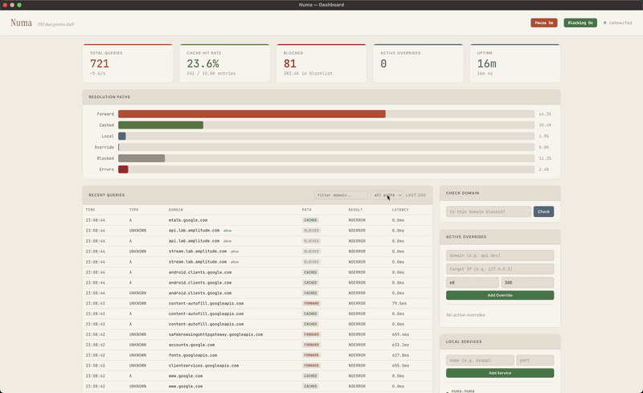

# Numa

[](https://github.com/razvandimescu/numa/actions)
[](https://crates.io/crates/numa)
[](LICENSE)

**DNS you own. Everywhere you go.** · [numa.rs](https://numa.rs)

A portable DNS resolver in a single binary. Block ads on any network, name your local services (`frontend.numa`), override any hostname with auto-revert, and optionally seal every outbound query with **ODoH (RFC 9230)**, so no single party sees both who you are and what you asked. It all runs on your laptop, with no cloud account or Raspberry Pi needed.

Built from scratch in Rust, with no DNS libraries. Numa can also resolve recursively with DNSSEC validation, serve DoT and DoH clients, and run as a public ODoH relay ([`numa relay`](packaging/relay/)).

The DNS wire-protocol parser is hand-written. Most later code was drafted with AI and reviewed by hand.



## Quick Start

### 1. Try it in Docker (nothing installed on the host)

```bash
docker run -d --name numa -p 127.0.0.1:5553:53/udp -p 127.0.0.1:5553:53/tcp \
  -p 127.0.0.1:5380:5380 ghcr.io/razvandimescu/numa
dig @127.0.0.1 -p 5553 example.com
docker exec numa numa token            # API token for the dashboard login
```

Open `http://localhost:5380` and log in with any username and that token. Port 5553 avoids whatever already holds port 53 on the host. `numa.numa` does not resolve here, because the host does not use Numa for DNS. Clean up with `docker rm -f numa`.

### 2. Run in the foreground (system DNS untouched)

Get the binary:

```bash
# macOS
brew install razvandimescu/tap/numa

# Linux
curl -fsSL https://raw.githubusercontent.com/razvandimescu/numa/main/install.sh | sh

# Arch Linux
pacman -S numa

# Windows: download from GitHub Releases
# All platforms
cargo install numa

# Nix
nix profile install github:razvandimescu/numa
```

On Linux, `sudo` does not search `~/.cargo/bin`, `~/.nix-profile/bin` or Linuxbrew. If numa is in one of these, use `sudo "$(command -v numa)"` wherever this page says `sudo numa`.

```bash
sudo numa                              # Ctrl-C to stop (port 53 requires root/admin)
```

Test it with `dig @127.0.0.1 example.com` (`@127.0.0.2` on Windows). The dashboard is at `http://localhost:5380`. By default, other devices on your network can also query Numa. To limit this, set `[server] allow_from` to the networks you trust.

### 3. Set as system DNS

| Platform | Install | Upgrade | Uninstall |
|----------|---------|---------|-----------|
| macOS | `sudo numa install` | update the binary, then `sudo numa install` | `sudo numa uninstall` |
| Linux | `sudo numa install` | update the binary, then `sudo "$(command -v numa)" install` | `sudo numa uninstall` |
| Windows | `numa install` (admin) + reboot | run the new `numa.exe install` (admin) | `numa uninstall` (admin) + reboot |

`install` registers a service, points system DNS at Numa and trusts its local CA. `uninstall` reverses all three. To check the install, open **http://numa.numa**. If the dashboard loads, Numa is your system DNS.

Update the binary the way you installed it (`brew upgrade`, `cargo install numa`, or rerun install.sh). Re-running `install` restarts the service on the new binary and keeps the token and CA.

On Linux, `install` reconfigures systemd-resolved with a drop-in file. `uninstall` removes it. Stop any other process that holds port 53 (dnsmasq, including NetworkManager's) before you install.

### Logging in

Over loopback (`localhost`, `127.0.0.1`, `numa.numa`), the dashboard and API need no login. From any other address, including Docker port mapping and this machine's LAN address, they ask for the API token. Numa creates the token on first start. Print it with `sudo numa token` (an administrator shell on Windows). Log in with any username and that token. To set your own token, use `[server] api_token` or `NUMA_API_TOKEN`.

### Removing every trace

`uninstall` restores DNS but keeps the data directory, so a reinstall keeps the same token and CA. To remove everything, run `uninstall` first, then delete:

| Platform | Left behind |
|----------|-------------|
| macOS | the binary, `/usr/local/var/numa`, `/usr/local/var/log/numa.log` |
| Linux | the binary and any copy at `/usr/local/bin/numa`, `/var/lib/numa` |
| Windows | the binary, `%PROGRAMDATA%\numa` |
| iPhone | the "Numa DNS" profile (Settings → General → VPN & Device Management) |

Also delete `~/.config/numa` if you created a user config. If you set `[server] data_dir`, delete that path too.

## How It Compares

| | Pi-hole | AdGuard Home | Unbound | Numa |
|---|---|---|---|---|
| Local service proxy + auto TLS | No | No | No | `.numa` domains, HTTPS, WebSocket |
| LAN service discovery | No | No | No | mDNS (`numa lan on`) |
| Overrides with auto-revert | No | No | No | REST API, scriptable |
| Recursive resolver | No | No | Yes | Yes |
| DNSSEC validation | Yes | Relies on upstream | Yes | Yes (recursive mode) |
| Ad blocking | Yes | Yes | No | Yes (Hagezi Pro default, custom lists) |
| Per-client rules | Groups | Yes | Views / tags | By CIDR (`[[client_policy]]`), config file only |
| Web admin UI | Full | Full | No | Dashboard |
| Encrypted upstream | Needs cloudflared | DoH, DoT, DoQ, DNSCrypt | DoT | DoH, DoT, ODoH |
| Encrypted clients (DoT listener) | Needs stunnel sidecar | Yes | Yes | Yes (RFC 7858) |
| DoH server endpoint | No | Yes | Yes | Yes (RFC 8484) |
| Parallel upstream queries | dnsmasq `all-servers` | Parallel mode | No | Request hedging (UDP, DoH, DoT) |
| Serve-stale + prefetch | No | Optimistic cache | Yes (RFC 8767, prefetch) | Yes (RFC 8767, prefetch) |
| Conditional forwarding | Yes | Yes | Yes | Yes (per-suffix rules) |
| Maturity | Mature | Mature | Mature | New |

**What Numa doesn't do.** No DHCP, no clustering, no config sync between instances. Most settings live in the config file, not the dashboard.

## Configuration

Settings live in one TOML file. `numa config path` prints which file your install uses. `numa config edit` opens it. After a change, run `sudo numa service restart`. `numa -c FILE` runs Numa, or these commands, on a file you choose. [`numa.toml`](numa.toml) documents every option inline.

On Windows, Numa listens on `127.0.0.2:53`, because the DNS Client service (Dnscache) owns `127.0.0.1:53`. Keep `127.0.0.2` when you edit `bind_addr`.

## Local Services

Name your dev services instead of remembering port numbers:

```bash
curl -X POST localhost:5380/services -H 'Content-Type: application/json' \
  -d '{"name":"frontend","target_port":5173}'
```

Once Numa is your system DNS (`numa install`), `https://frontend.numa` works in your browser, with a valid certificate and WebSocket passthrough for HMR. No mkcert, no nginx, no `/etc/hosts`.

You can also add path-based routing (`app.numa/api → :5001`) or define services in [`numa.toml`](numa.toml). Firefox keeps its own certificate store and ignores the system one. To use `.numa` HTTPS in Firefox, trust the Numa CA there manually.

## Ad Blocking & Privacy

Numa blocks ads and trackers with [Hagezi Pro](https://github.com/hagezi/dns-blocklists), refreshed daily.

Resolution modes, set with `[upstream] mode`:

- **`forward`** (default): forwards to your existing system DNS, with caching and ad blocking on top. Captive portals, VPNs and corporate DNS keep working.
- **`recursive`**: resolves from the root servers. No single resolver sees all your queries, but the queries are not encrypted, so your network and ISP can still read them. To validate DNSSEC, run `numa dnssec on`.
- **`auto`**: probes the root servers at startup and resolves recursively if they answer. If not, it forwards over DoH to Quad9 (`https://9.9.9.9/dns-query`), which then sees your queries. If Quad9 fails, Numa retries with Cloudflare (`https://1.1.1.1/dns-query`). To pick a different provider, use `forward` with your own `[upstream]`.
- **`odoh`**: seals each query for the target with HPKE and sends it through a relay ([recipe](recipes/odoh-upstream.md)). The relay sees your IP and ciphertext. The target sees the question and the relay's IP. A relay that redirects the query hands the new destination something it cannot decrypt. Numa refuses a relay and target that share a registrable domain. ODoH does not hide the connection you open afterwards: your ISP still sees the destination IP and, without ECH, the hostname in the TLS handshake.

**DNS-over-TLS listener** (RFC 7858). Numa accepts encrypted queries on port 853 from clients such as iOS Private DNS, systemd-resolved and stubby. Two certificate modes:

- **Self-signed** (default): Numa creates a local CA. `numa install` adds it to the system trust store on macOS, Linux (Debian/Ubuntu, Fedora/RHEL/SUSE, Arch) and Windows. `numa uninstall` removes it.
- **Bring your own cert**: point `[dot] cert_path` and `key_path` at a publicly trusted certificate, for example from Let's Encrypt through a DNS-01 challenge. Clients then connect without trust-store setup.

**Phone setup.** Point your iPhone at Numa. Set `[mobile] enabled = true` in `numa.toml` and restart Numa. With the phone on the same network, run:

```bash
numa setup-phone
```

It prints a QR code and the install steps. When you finish them, your phone sends DNS to Numa over TLS.

## LAN Discovery

Run Numa on several machines. They find each other through mDNS:

```
Machine A (192.168.1.5)              Machine B (192.168.1.20)
┌──────────────────────┐             ┌──────────────────────┐
│ Numa                 │    mDNS     │ Numa                 │
│  - api (port 8000)   │◄───────────►│  - grafana (3000)    │
│  - frontend (5173)   │  discovery  │                      │
└──────────────────────┘             └──────────────────────┘
```

From Machine B, `curl http://api.numa` reaches port 8000 on Machine A. Turn this on with `numa lan on`.

**Network-wide.** Point other devices' DNS at one Numa instance. They get ad blocking and `.numa` names without installing anything. Setup: [network-wide recipe](recipes/network-wide.md).

## Docker

```bash
# Host networking (Linux, recommended)
docker run -d --name numa --network host -v numa-data:/var/lib/numa ghcr.io/razvandimescu/numa

# Port mapping (Docker Desktop on macOS and Windows)
docker run -d --name numa -p 53:53/udp -p 53:53/tcp -p 5380:5380 -v numa-data:/var/lib/numa ghcr.io/razvandimescu/numa
```

The dashboard is at `http://localhost:5380`. With port mapping, or from another device, log in with any username and the token from `docker exec numa numa token`. The `numa-data` volume keeps the token and the local CA when you recreate the container. The image binds the API and proxy to `0.0.0.0` by default. To use your own config, mount it:

```bash
docker run -d --name numa --network host -v numa-data:/var/lib/numa \
  -v /path/to/numa.toml:/root/.config/numa/numa.toml \
  ghcr.io/razvandimescu/numa
```

Images: `linux/amd64` and `linux/arm64`.

Compose recipes:
- [`packaging/client/`](packaging/client/): ODoH client mode, Numa with a starter `numa.toml`.
- [`packaging/relay/`](packaging/relay/): public ODoH relay, Numa with Caddy and ACME.

## Running Numa as Your Primary DNS

**If Numa stops.** launchd (macOS) and systemd (Linux) restart Numa when it exits. Until it restarts, DNS lookups fail if Numa is your only resolver.

If Numa runs but cannot reach its upstreams, it serves cached answers for up to an hour past their TTL (RFC 8767). Names it has not cached fail.

**Privileges.** The systemd unit runs unprivileged (`DynamicUser=yes`, only `CAP_NET_BIND_SERVICE`). The launchd daemon runs as root.

**Testing.** CI fuzzes the DNS parser on every pull request that touches it. Longer fuzzing runs weekly ([`fuzz.yml`](.github/workflows/fuzz.yml)). CI also runs `cargo audit` on dependencies. It installs, reinstalls and uninstalls Numa on macOS and Linux.

**Resolver hardening.** In recursive mode, Numa drops answer records outside the zone being queried. It does not query nameservers at private or loopback addresses. It caps the upstream queries and referral depth of each lookup. Replies over plain UDP must match the query's random transaction ID and question. Numa refuses ANY queries. To report a vulnerability privately, see [SECURITY.md](SECURITY.md).

## Performance

Cached queries take 0.1 ms, the same as Unbound and AdGuard Home. Request hedging reduces tail latency. In the April 2026 cold recursive benchmark, p99 was 538 ms for Numa and 748 ms for Unbound. [Benchmarks →](benches/)

## Learn More

- [Blog: Numa as your tailnet resolver](https://numa.rs/blog/posts/numa-tailnet-resolver.html)
- [Blog: DNS-over-TLS from Scratch in Rust](https://numa.rs/blog/posts/dot-from-scratch.html)
- [Blog: Implementing DNSSEC from Scratch in Rust](https://numa.rs/blog/posts/dnssec-from-scratch.html)
- [Blog: I Built a DNS Resolver from Scratch](https://numa.rs/blog/posts/dns-from-scratch.html)
- [REST API](src/api.rs): overrides, cache, blocking, services, diagnostics
- [numa-metrics](https://github.com/razvandimescu/numa-metrics): query history and analytics, stored off-host (no SD-card writes)

## License

MIT
